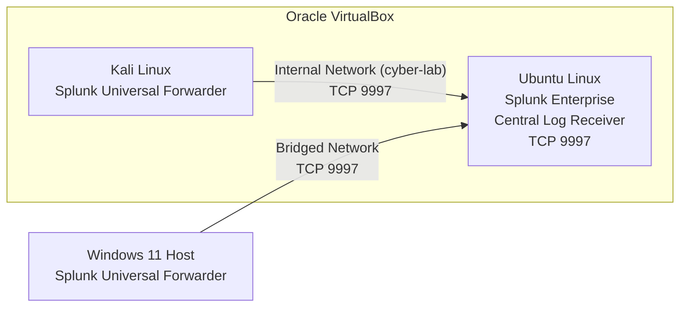
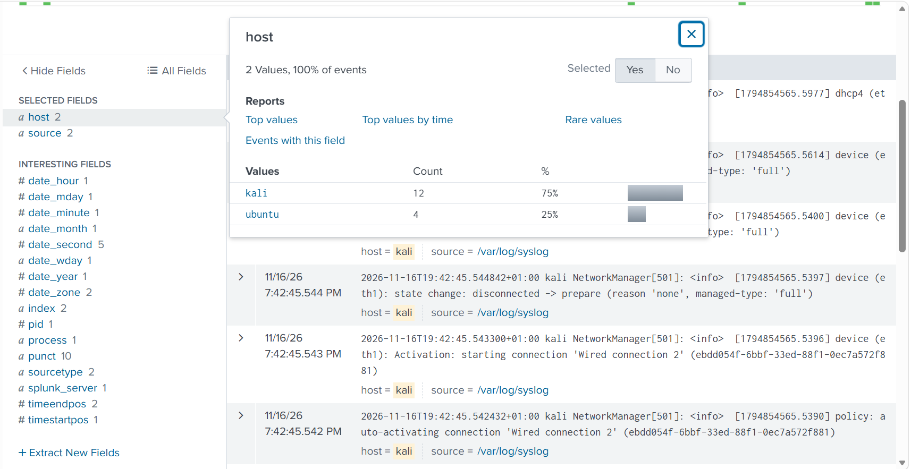
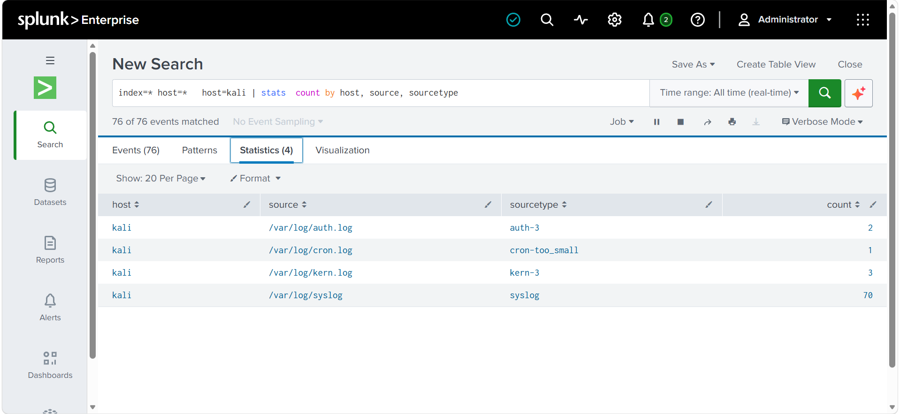
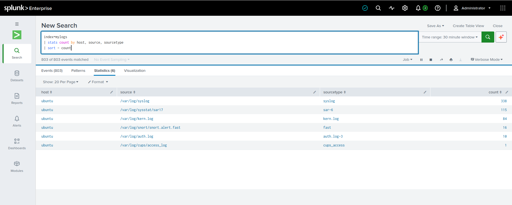
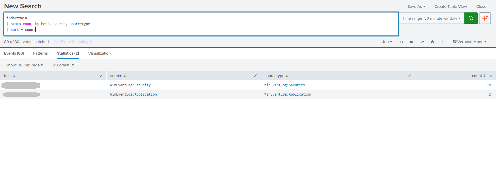

## 1. Project Overview

This project demonstrates centralized log collection and forwarding using Splunk Universal Forwarder and Splunk Enterprise in a VirtualBox cybersecurity lab.

The lab uses three log sources:

- **Kali Linux:** Sends Linux system logs to Splunk Enterprise using Splunk Universal Forwarder.
- **Windows 11:** Sends Windows Event Logs using Splunk Universal Forwarder.
- **Ubuntu Linux:** Collects its own local system and Apache logs using Splunk Enterprise.

Ubuntu Linux hosts the central Splunk Enterprise instance, which receives forwarded events from Kali Linux and Windows 11 and collects its own local logs.

The objective is to configure, test and validate centralized log forwarding from multiple operating systems.


### Project Objectives

- Configure Splunk Universal Forwarder on Kali Linux and Windows 11.
- Install and operate Splunk Enterprise on Ubuntu Linux.
- Configure centralized log forwarding from multiple systems.
- Verify communication using TCP port 9997.
- Configure local monitoring of Ubuntu system and Apache logs.
- Verify log ingestion and identify indexes, hosts, sources and sourcetypes in Splunk.
- Validate successful log collection from multiple operating systems.

---

## 2. Lab Environment

The project uses a virtualised cybersecurity lab running on Windows 11 with Oracle VirtualBox and a Windows host Universal Forwarder.

### Lab Components

| Component | Configuration |
|---|---|
| Host Operating System | Windows 11 |
| Virtualisation Platform | Oracle VirtualBox |
| SIEM Server | Ubuntu Linux |
| SIEM Platform | Splunk Enterprise |
| Log Source 1 | Kali Linux |
| Log Source 2 | Windows 11 Host |
| Log Source 3 | Ubuntu Linux |
| Log Forwarder | Splunk Universal Forwarder |
| Communication Protocol | TCP |
| Receiving Port | 9997 |

### Virtual Machine and Log Collection Details

| Machine | Purpose | Collection Method |
|---|---|---|
| Kali Linux | Linux system log collection | Splunk Universal Forwarder |
| Ubuntu Linux | Central SIEM and local log collection | Splunk Enterprise local monitoring |
| Windows 11 | Windows event collection | Splunk Universal Forwarder |

### Network Configuration

| Source | Destination Interface on Ubuntu | Network Type |
|---|---|---|
| Kali Linux | Internal Network interface | `cyber-lab` |
| Windows 11 | Bridged Adapter interface | Bridged Network |
| Ubuntu Linux | Local Splunk instance | Local monitoring |

**Note:** Ubuntu uses two network interfaces: one Bridged Adapter and one Internal Network interface. Both connect to the same Splunk Enterprise instance.

---


## 3. Installation Details

### Ubuntu Linux – Splunk Enterprise

Splunk Enterprise is installed on Ubuntu Linux and acts as the central SIEM server. It receives forwarded logs from Kali Linux and Windows 11 and collects its own local system logs.

| Item | Details |
|---|---|
| Platform | Ubuntu Linux |
| Software | Splunk Enterprise |
| Installation Directory | `/opt/splunk` |
| Web Interface Port | `8000` |
| Receiving Port | `9997/TCP` |
| Function | Central log collection, indexing and analysis |

### Kali Linux – Splunk Universal Forwarder

Splunk Universal Forwarder is installed on Kali Linux to collect Linux system logs and forward them to the central Splunk Enterprise instance on Ubuntu.

| Item | Details |
|---|---|
| Platform | Kali Linux |
| Software | Splunk Universal Forwarder |
| Installation Directory | `/opt/splunkforwarder` |
| Function | Linux log collection and forwarding |
| Destination | Ubuntu Splunk Enterprise |
| Destination Port | `9997/TCP` |

### Windows 11 – Splunk Universal Forwarder

Splunk Universal Forwarder is installed on the Windows 11 host to collect Windows Event Logs and forward them to the central Splunk Enterprise instance on Ubuntu.

| Item | Details |
|---|---|
| Platform | Windows 11 |
| Software | Splunk Universal Forwarder |
| Function | Windows Event Log collection and forwarding |
| Destination | Ubuntu Splunk Enterprise |
| Destination Port | `9997/TCP` |

**Note:** Kali Linux and Windows 11 act as log sources. Their Universal Forwarders send events to Ubuntu Linux. Ubuntu hosts Splunk Enterprise, which listens for incoming forwarded events on TCP port `9997`.


---


## 4. Network and Forwarding Configuration

### Network Architecture

The lab uses Oracle VirtualBox to run Kali Linux and Ubuntu Linux as virtual machines on a Windows 11 host.

Splunk Universal Forwarder is installed on Kali Linux and the Windows 11 host to collect and forward logs to the central Splunk Enterprise instance running on Ubuntu Linux.

The following diagram illustrates the centralized log forwarding architecture in the VirtualBox lab.


### Network Interfaces

Ubuntu Linux uses two network interfaces to communicate with the different log sources.

| Ubuntu Network Interface | Network Mode | Purpose |
|---|---|---|
| Bridged Adapter | Bridged Network | Communication with the Windows 11 host |
| Internal Network | `cyber-lab` | Communication with Kali Linux |

### Log Forwarding Configuration

| Log Source | Destination | Port | Forwarding Method |
|---|---|---|---|
| Kali Linux | Ubuntu Internal Network IP | `9997/TCP` | Splunk Universal Forwarder |
| Windows 11 Host | Ubuntu Bridged Adapter IP | `9997/TCP` | Splunk Universal Forwarder |
| Ubuntu Linux | Local Splunk Enterprise instance | Local monitoring | Splunk Enterprise |

The actual IP addresses are represented by placeholders in this public repository to avoid exposing personal network details.

### Kali Linux – Forwarding Configuration

The Kali Linux Universal Forwarder is configured to collect Linux system logs and forward them to the Ubuntu Splunk Enterprise instance through the Internal Network interface.

Configuration file:

`/opt/splunkforwarder/etc/system/local/outputs.conf`

The forwarding destination is configured using the Ubuntu Internal Network IP address and TCP port `9997`.

### Windows 11 – Forwarding Configuration

The Windows Universal Forwarder is configured to collect Windows Event Logs and forward them to the Ubuntu Splunk Enterprise instance through the Bridged Network interface.

The forwarding destination uses the Ubuntu Bridged Adapter IP address and TCP port `9997`.

### Ubuntu Linux – Local Log Collection

Ubuntu Linux also collects its own local system and Apache logs using Splunk Enterprise monitoring.

These events are collected locally and do not require forwarding through a separate Universal Forwarder.

### Splunk Receiving Configuration

Splunk Enterprise on Ubuntu is configured to receive forwarded events through TCP port `9997`.

The receiving port listens on the Ubuntu network interfaces, allowing both Kali Linux and Windows 11 to send events to the same central Splunk Enterprise instance.

### Communication Overview

- **Kali Linux → Ubuntu:** Log forwarding through the VirtualBox Internal Network (`cyber-lab`).
- **Windows 11 Host → Ubuntu:** Log forwarding through the Bridged Network.
- **Ubuntu Linux:** Collects its own local system logs.
- **TCP port 9997:** Receives forwarded events from Kali Linux and Windows 11.
- **TCP port 8000:** Provides access to the Splunk Web interface for searching and analysing events.


---


## 5. Service and Port Validation

Splunk services and network connectivity were checked to verify that Splunk Enterprise was running on Ubuntu Linux and that the Kali Linux Universal Forwarder could successfully forward events to the central Splunk instance.

### 5.1 Starting and Stopping Splunk Services

The following commands are used to manage Splunk services manually.

#### Ubuntu Linux – Splunk Enterprise

Start Splunk Enterprise:

```bash
sudo /opt/splunk/bin/splunk start
```

Stop Splunk Enterprise:

```bash
sudo /opt/splunk/bin/splunk stop
```

Check service status:

```bash
sudo /opt/splunk/bin/splunk status
```

#### Kali Linux – Splunk Universal Forwarder

Start Splunk Universal Forwarder:

```bash
sudo /opt/splunkforwarder/bin/splunk start
```

Stop Splunk Universal Forwarder:

```bash
sudo /opt/splunkforwarder/bin/splunk stop
```

Check service status:

```bash
sudo /opt/splunkforwarder/bin/splunk status
```

**Note:** The `sudo` command runs the Splunk management command with elevated privileges. The configured Splunk service account determines which user runs the Splunk processes.

### 5.2 Ubuntu Linux – Receiving Port Validation

The receiving port was checked using:

```bash
sudo ss -tlnp | grep ':9997'
```

The output confirmed that Splunk Enterprise was listening on TCP port `9997`:

```text
LISTEN 0 128 0.0.0.0:9997 0.0.0.0:* users:(("splunkd",...))
```

This verified that the Splunk receiving port was listening on the Ubuntu network interfaces.

### 5.3 Kali Linux – Forwarding Destination Validation

The configured forwarding destination was checked using:

```bash
sudo /opt/splunkforwarder/bin/splunk list forward-server
```

The output confirmed:

- Active forwarding destination: Ubuntu Internal Network IP on port `9997`.
- Configured but inactive forwarding destinations: None.

This confirmed that the Kali Universal Forwarder had an active connection to the Ubuntu Splunk Enterprise instance.

### 5.4 Kali Linux – Network Connectivity Test

Connectivity to the Ubuntu receiving port was tested using:

```bash
nc -vz <UBUNTU_INTERNAL_IP> 9997
```

The connection test confirmed that TCP port `9997` was reachable from Kali Linux.

### 5.5 Validation Summary

| Validation | System | Result |
|---|---|---|
| Splunk Enterprise service status | Ubuntu Linux | Running |
| Receiving port `9997` | Ubuntu Linux | Listening |
| Universal Forwarder service status | Kali Linux | Running |
| Forwarding destination | Kali Linux | Active |
| TCP connectivity to port `9997` | Kali Linux | Successful |

These checks confirmed that the Ubuntu Splunk Enterprise instance was ready to receive forwarded logs from Kali Linux.

---

## 6. Log Ingestion Validation

Splunk Search & Reporting was used to verify that log events from Kali Linux, Ubuntu Linux and the Windows 11 host were successfully collected and indexed by Splunk Enterprise.

### 6.1 Kali Linux – Log Ingestion

The following SPL query was used to verify incoming events from Kali Linux:

```spl
index=kalilogs
| stats count by host, source, sourcetype
| sort - count
```

The search results confirmed that Kali Linux system events were successfully received and stored in the `kalilogs` index.

### 6.2 Ubuntu Linux – Local Log Ingestion

Ubuntu Linux collects its own local system logs using Splunk Enterprise monitoring.

The following SPL query was used to verify local log ingestion:

```spl
index=mylogs
| stats count by host, source, sourcetype
| sort - count
```

The search results confirmed that Ubuntu Linux local events were available in the `mylogs` index.

### 6.3 Windows 11 – Log Ingestion

Windows Event Logs are collected using Splunk Universal Forwarder installed on the Windows 11 host.

The collected events are stored in Splunk's default `main` index.

The following SPL query was used to verify the available Windows events:

```spl
index=main
| stats count by host, source, sourcetype
| sort - count
```

The search results confirmed the presence of Windows Event Log data, including the `WinEventLog:Security` sourcetype.

Security-related Event IDs observed included:

- `4624` – Successful account logon.
- `4672` – Special privileges assigned to a new logon.

### 6.4 Log Ingestion Summary

| Log Source | Collection Method | Splunk Index |
|---|---|---|
| Kali Linux | Splunk Universal Forwarder | `kalilogs` |
| Ubuntu Linux | Splunk Enterprise local monitoring | `mylogs` |
| Windows 11 | Splunk Universal Forwarder | `main` |

The validation demonstrated successful log collection from multiple operating systems into a central Splunk Enterprise instance.

**Note:** Event counts may change as new events are generated. The SPL queries can be reused to verify ongoing log ingestion.

---


## 7. Screenshots and Evidence

The following screenshots provide visual evidence of the Splunk log forwarding and ingestion validation performed in the lab.

### 7.1 Kali Linux – Log Ingestion

This screenshot demonstrates that Linux system logs from Kali Linux were successfully received and indexed in Splunk Enterprise.



### 7.2 Kali Linux – Log Source Overview

This screenshot shows the different Kali Linux log sources available in Splunk.



### 7.3 Ubuntu Linux – Local Log Ingestion

This screenshot demonstrates successful collection of Ubuntu Linux system logs using Splunk Enterprise local monitoring.



### 7.4 Windows 11 – Log Ingestion

This screenshot demonstrates successful collection of Windows Event Logs using Splunk Universal Forwarder.



---

## 8. Learning Outcomes

This project provided practical experience to the following:

- Installing and managing Splunk Universal Forwarder on Linux and Windows.
- Installing and operating Splunk Enterprise on Ubuntu Linux.
- Configuring centralized log forwarding from multiple systems.
- Understanding Splunk receiving ports and TCP communication.
- Configuring and validating network connectivity between different systems.
- Checking Splunk services, forwarding destinations and listening ports.
- Verifying log ingestion from Kali Linux, Windows 11 and Ubuntu Linux.
- Identifying indexes, hosts, sources and sourcetypes in Splunk.
- Using Splunk Search & Reporting to validate collected events.

---

## 9. Future Improvements

- Practise Splunk Search Processing Language (SPL) in more detail.
- Perform detailed Linux and Windows log analysis.
- Create dashboards for system and security monitoring.
- Develop alerts for failed authentication attempts.
- Investigate suspicious system and network activity.
- Integrate additional lab machines as log sources.
- Explore security event correlation and detection use cases.

---

## 10. Project Status

**Completed:**
- Splunk Enterprise installation and configuration on Ubuntu Linux.
- Splunk Universal Forwarder configuration on Kali Linux and Windows 11.
- Centralized log forwarding to Ubuntu using TCP port `9997`.
- Receiving port and network connectivity validation.
- Successful log ingestion verification from Kali Linux, Windows 11 and Ubuntu Linux.
- Screenshot evidence of log ingestion from Kali Linux, Ubuntu Linux and Windows 11.

**Future work:** Advanced SPL practice, detailed log analysis, dashboards, security alerts and additional detection use cases.

