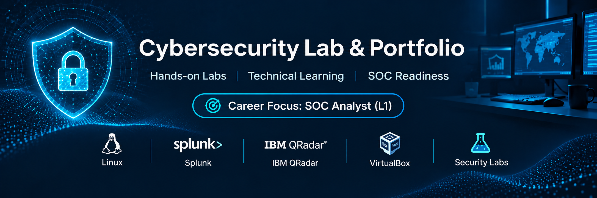

# Cybersecurity Home Lab Portfolio

Welcome to my cybersecurity portfolio!

I am developing practical cybersecurity skills through hands-on home lab projects, technical exercises and security investigations using Linux environments, virtual machines and SIEM platforms.

This portfolio documents my technical learning, lab configurations, troubleshooting activities and practical projects as I work towards a career in Security Operations.

## Career Focus

**Target Role:** Junior SOC Analyst / Security Operations Analyst

Areas of focus:

- Security monitoring
- SIEM and log management
- Security event analysis
- Threat detection fundamentals
- Network security
- Incident response fundamentals

## Lab Environment & Technologies

| Category | Technologies |
|---|---|
| Virtualisation | Oracle VirtualBox |
| Operating Systems | Kali Linux, Ubuntu Linux, Windows 11 |
| Vulnerable Lab | Metasploitable2 |
| SIEM Platforms | Splunk Enterprise, IBM QRadar |
| Network Tools | Nmap, tcpdump |
| Query Language | Splunk Search Processing Language (SPL) |

## Technical Skills & Learning Areas

### 1. Linux Administration

- Linux fundamentals and command-line operations
- File and directory management
- User and permission management
- Network interface configuration
- Linux log files and troubleshooting

### 2. Networking & Network Security

- IPv4 addressing and static IP configuration
- NAT, Bridged Adapter and Internal Network
- Network connectivity testing using ICMP
- Network scanning with Nmap
- Packet analysis fundamentals using tcpdump

### 3. Vulnerability Assessment

- Metasploitable2 lab environment
- Service enumeration
- Vulnerability identification
- Understanding security risks and remediation recommendations

### 4. SIEM & Security Monitoring

- Splunk Enterprise installation and configuration
- Splunk Universal Forwarder configuration
- Centralised log forwarding and ingestion
- Basic SPL searches for log ingestion validation
- Understanding SIEM concepts
- IBM QRadar installation and planned lab exploration

### 5. Virtualisation & Lab Infrastructure

- VirtualBox installation and configuration
- Multi-VM lab architecture
- Isolated lab network configuration
- Static IP configuration across virtual machines
- Network troubleshooting and connectivity verification

## Practical Projects

### 1. VirtualBox Cybersecurity Home Lab

**Status:** Initial setup completed

Built a multi-VM cybersecurity lab using Kali Linux, Ubuntu Linux and Metasploitable2.

Practical work includes:

- Virtual machine network configuration
- Static IPv4 configuration
- Internal network setup
- Connectivity testing between virtual machines
- Reboot persistence verification

**Documentation:** [Cybersecurity Home Lab](03-Cybersecurity-Home-Lab/README.md)

### 2. Linux Network Configuration & Connectivity Testing

**Status:** Completed

Configured persistent static IP addresses for Kali Linux, Ubuntu Linux and Metasploitable2.

Verified network connectivity and confirmed that configurations persisted after reboot.

- [Static IP Configuration](03-Cybersecurity-Home-Lab/network-configuration/static-ip-configuration.md)
- [Connectivity Testing](03-Cybersecurity-Home-Lab/network-configuration/connectivity-testing.md)

### 3. Splunk Log Forwarding & Ingestion

**Status:** Log forwarding validated

Configured Splunk Enterprise on Ubuntu Linux as a central log collection platform, with Splunk Universal Forwarder on Kali Linux and Windows 11.

Practical work includes:

- Splunk Enterprise installation and configuration
- Splunk Universal Forwarder configuration
- Centralised log forwarding over TCP port `9997`
- Log ingestion validation across Linux and Windows
- Identification of hosts, sources, sourcetypes and indexes
- Basic SPL searches for ingestion validation

**Documentation:** [Splunk Log Forwarding](03-Cybersecurity-Home-Lab/splunk/log-forwarding.md)

## Continuous Learning

I continue to develop my technical knowledge through hands-on cybersecurity labs, practical exercises, troubleshooting and technical documentation.

My goal is to strengthen my practical skills and build the foundation required for a Junior SOC Analyst role.

**Areas of Interest:** SOC Operations | SIEM | Security Monitoring | Threat Detection | Incident Response | Network Security

---

*This portfolio documents my ongoing cybersecurity learning journey. Projects and documentation are updated as new practical exercises are completed.*
