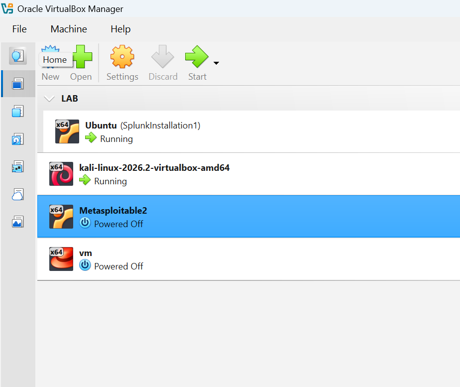

# Project 01 – Cybersecurity Home Lab Infrastructure

## 1. Project Overview

This project documents the design, installation and configuration of my cybersecurity home lab using Oracle VirtualBox.

The environment is used to practise Linux administration, network security, vulnerability assessment, SIEM operations and log analysis.

The lab includes Kali Linux, Ubuntu Linux, Metasploitable2, IBM QRadar and Splunk Enterprise. The Windows 11 host is also configured as a log source using Splunk Universal Forwarder.

## 2. Host Environment

| Component | Configuration |
|---|---|
| Host Operating System | Windows 11 |
| Virtualisation Platform | Oracle VirtualBox |
| Lab Type | Virtualised cybersecurity environment |
| Network Configuration | NAT, Bridged Adapter and Internal Network |

## 3. Virtual Machine Inventory

| Virtual Machine | Purpose | Status |
|---|---|---|
| Kali Linux | Security testing, network scanning and Splunk Universal Forwarder | Installed |
| Ubuntu Linux | Linux administration and Splunk Enterprise | Installed |
| Metasploitable2 | Vulnerability assessment and penetration-testing practice | Installed |
| IBM QRadar | SIEM monitoring and security event investigation | Installed |

### Virtual Machine Overview

## 4. Network Architecture

The lab uses different VirtualBox network modes depending on the purpose of each virtual machine.

- **NAT:** Provides network access to a virtual machine through VirtualBox's network address translation.
- **Bridged Adapter:** Connects a virtual machine through the physical network interface of the Windows host.
- **Internal Network:** Allows selected virtual machines to communicate through a private virtual network.

An Internal Network named `cyber-lab` is configured for Kali Linux, Ubuntu Linux and Metasploitable2.

For Splunk log forwarding:

- Kali Linux communicates with Ubuntu through the `cyber-lab` Internal Network.
- The Windows 11 host communicates with Ubuntu through the Bridged Network.
- Both systems forward events to the same Splunk Enterprise instance on Ubuntu using TCP port `9997`.
- Ubuntu also collects its own local system and Apache logs.

## 5. Network Configuration Details

The virtual machines use a combination of NAT, Bridged Adapter and Internal Network configurations.

| Virtual Machine | Adapter | Network Mode | Network Name |
|---|---|---|---|
| Kali Linux | Adapter 1 | NAT | — |
| Kali Linux | Adapter 2 | Internal Network | cyber-lab |
| Ubuntu Linux | Adapter 1 | Bridged Adapter | — |
| Ubuntu Linux | Adapter 2 | Internal Network | cyber-lab |
| Metasploitable2 | Adapter 1 | Internal Network | cyber-lab |
| IBM QRadar | Adapter 1 | Bridged Adapter | — |

The internal network `cyber-lab` enables communication between Kali Linux, Ubuntu Linux and Metasploitable2.

Ubuntu Linux uses its bridged network interface for external network connectivity and its internal network interface for communication within the lab.

## 6. Splunk Integration

Splunk Enterprise is installed on Ubuntu Linux and acts as the central log collection and SIEM platform.

Splunk Universal Forwarder is installed on Kali Linux and the Windows 11 host to collect and forward logs to Ubuntu. Ubuntu also collects its own local system and Apache logs using Splunk Enterprise monitoring.

### Log Collection Architecture

| Component | Configuration |
|---|---|
| SIEM Server | Ubuntu Linux |
| SIEM Platform | Splunk Enterprise |
| Log Source 1 | Kali Linux |
| Log Source 2 | Windows 11 Host |
| Log Source 3 | Ubuntu Linux |
| Forwarder | Splunk Universal Forwarder |
| Receiving Port | TCP `9997` |

### Log Forwarding Configuration

| Log Source | Collection Method | Splunk Index |
|---|---|---|
| Kali Linux | Splunk Universal Forwarder | `kalilogs` |
| Windows 11 | Splunk Universal Forwarder | `main` |
| Ubuntu Linux | Splunk Enterprise local monitoring | `mylogs` |

### Validation Performed

- Verified Splunk Enterprise service on Ubuntu.
- Verified Splunk Universal Forwarder service on Kali.
- Confirmed Ubuntu was listening on TCP port `9997`.
- Verified the active Kali forwarding destination.
- Confirmed successful log ingestion from Kali Linux, Windows 11 and Ubuntu Linux.
- Identified log hosts, sources, sourcetypes and indexes in Splunk.

**Note:** Windows Event Logs are stored in Splunk's default `main` index.

### Detailed Documentation

[Splunk Log Forwarding and Ingestion](splunk/log-forwarding.md)

## 7. Connectivity Testing

Network connectivity from Kali Linux to Ubuntu Linux and Metasploitable2 was tested over the `cyber-lab` Internal Network.

The connectivity tests were successfully completed, including validation after restarting the virtual machines.

For detailed test commands, configurations and results, see [Network Connectivity Testing](network-configuration/connectivity-testing.md).

## 8. Security Considerations

Metasploitable2 is an intentionally vulnerable operating system designed for security testing.

Security precautions:

- Keep Metasploitable2 on an isolated Internal Network.
- Avoid connecting vulnerable machines directly to the home network.
- Restrict communication with vulnerable machines to the lab environment.
- Avoid exposing vulnerable services to external networks.
- Do not publish passwords, credentials, public IP addresses or sensitive configuration details.

## 9. Evidence and Screenshots

Screenshots are stored in the `screenshots` directory.

| Screenshot | Description |
|---|---|
| `screenshots/virtualbox/virtualbox-vm-inventory.png` | VirtualBox virtual machine inventory |
| `screenshots/splunk/splunk-log-ingestion.png` | Kali Linux log ingestion validation |
| `screenshots/splunk/splunk-kali-log-analysis.png` | Kali Linux log source overview in Splunk |
| `screenshots/splunk/ubuntu-log-ingestion.png` | Ubuntu Linux local log ingestion validation |
| `screenshots/splunk/windows-log-ingestion.png` | Windows 11 Event Log ingestion validation |

Additional screenshots may be added as further network and SIEM configuration activities are documented.

## 10. Learning Outcomes

Through this project, I am developing practical experience in:

- Virtualisation and virtual machine management.
- VirtualBox networking modes: NAT, Bridged Adapter and Internal Network.
- Linux network interface configuration.
- IP address and default gateway identification.
- Network isolation for vulnerable testing environments.
- Splunk Universal Forwarder and Splunk Enterprise.
- Centralised log collection from Linux and Windows systems.
- SIEM monitoring and basic log analysis.

## 11. Future Improvements

- Document IP addressing and routing in greater detail.
- Add further network configuration and connectivity evidence screenshots.
- Configure additional Linux log sources.
- Practise Splunk Search Processing Language (SPL).
- Create Splunk dashboards and security alerts.
- Integrate additional log sources into SIEM platforms.
- Practise vulnerability assessment using Metasploitable2.
- Develop security monitoring and incident investigation use cases.

---

**Project Status:** Virtual machines installed, network configuration documented, connectivity from Kali Linux to Ubuntu Linux and Metasploitable2 validated, and centralised Splunk log collection confirmed across Kali Linux, Ubuntu Linux and Windows 11. Further SIEM configuration, log analysis and security testing are ongoing.
