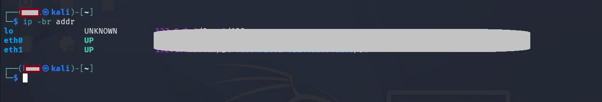
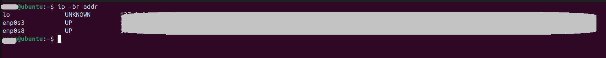
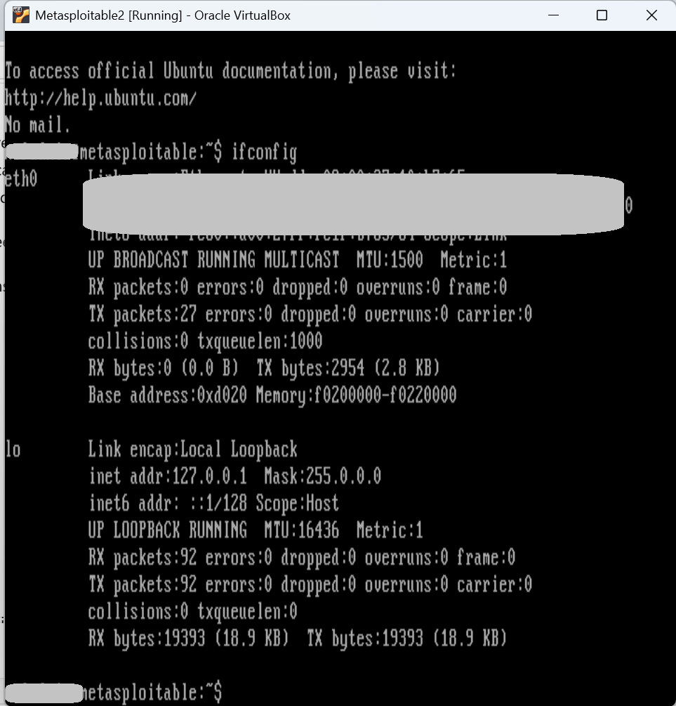
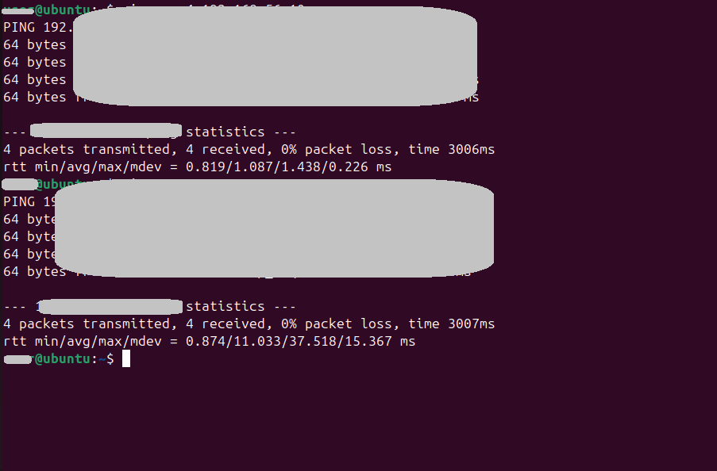

# Network Connectivity Testing – VirtualBox Cybersecurity Lab

## 1. Objective

Verify network communication between Kali Linux, Ubuntu Linux and Metasploitable2 using ICMP ping tests.

The virtual machines are connected through an isolated VirtualBox Internal Network named `cyber-lab`.

## 2. Lab Environment

| Virtual Machine | Network Interface | Lab IP Address |
|---|---|---|
| Kali Linux | eth1 | 192.168.56.X |
| Ubuntu Linux | enp0s8 | 192.168.56.X |
| Metasploitable2 | eth0 | 192.168.56.X |

*Actual IP addresses have been masked for privacy.*

## 3. Connectivity Tests

ICMP ping was used to verify communication between the virtual machines.

### Test 1 – Kali Linux to Ubuntu

```bash
ping -c 4 <UBUNTU_LAB_IP>
```

**Result:** Successful connectivity confirmed.

### Test 2 – Kali Linux to Metasploitable2

```bash
ping -c 4 <METASPLOITABLE_LAB_IP>
```

**Result:** Successful connectivity confirmed.

### Test 3 – Ubuntu to Kali Linux

```bash
ping -c 4 <KALI_LAB_IP>
```

**Result:** Successful connectivity confirmed.

### Test 4 – Ubuntu to Metasploitable2

```bash
ping -c 4 <METASPLOITABLE_LAB_IP>
```

**Result:** Successful connectivity confirmed.

## 4. Verification

The following command was used to inspect network interfaces and their assigned IP addresses:

```bash
ip -br addr
```

Metasploitable2 network configuration was checked using:

```bash
ifconfig eth0
```

## 5. Results

- Network interfaces were active.
- Static IPv4 addresses were configured on the three virtual machines.
- Successful ICMP connectivity was confirmed from Kali and Ubuntu.
- The lab machines communicate through the isolated `cyber-lab` network.

## 6. Learning Outcomes

- Practised ICMP connectivity testing.
- Verified communication between multiple Linux virtual machines.
- Learned to troubleshoot network interface and IP configuration issues.
- Understood the role of an isolated VirtualBox Internal Network.

### 7. Post-Reboot Connectivity Verification

Connectivity between Kali Linux, Ubuntu, and Metasploitable2 was successfully verified again after restarting all three virtual machines.

## 8. Screenshots and Evidence

### Evidence 1 – Kali Linux Network Interfaces



### Evidence 2 – Ubuntu Linux Network Interfaces



### Evidence 3 – Metasploitable2 Static IP Configuration



### Evidence 4 – Lab Network Connectivity Test


