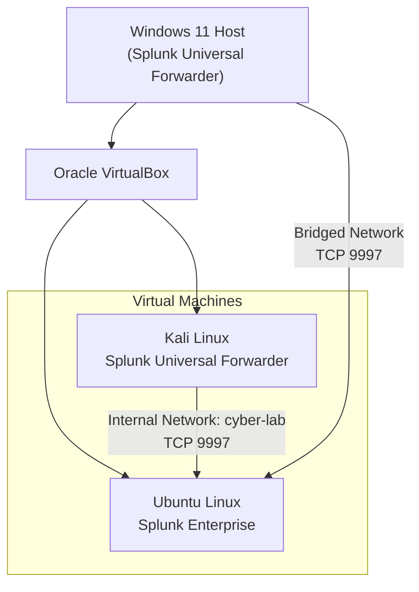
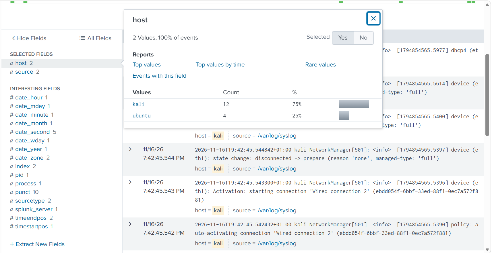
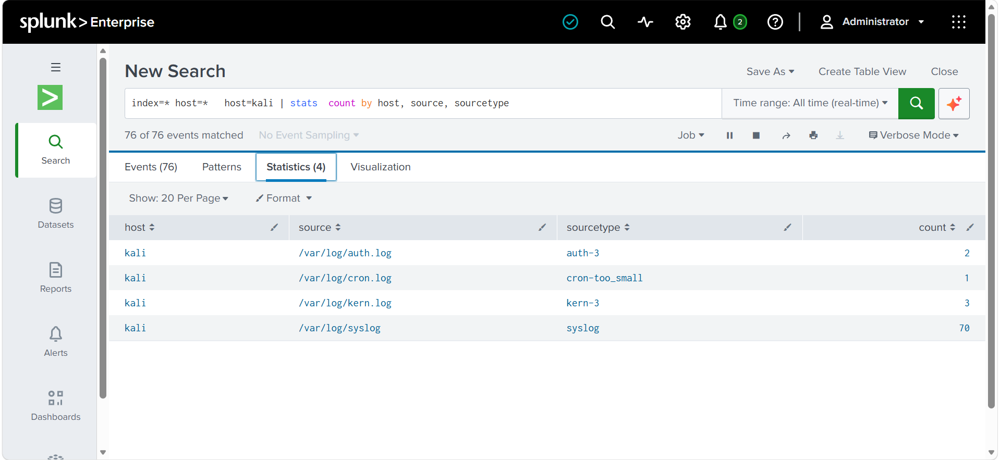

## 1. Project Overview

This project demonstrates centralized log collection and analysis using Splunk Universal Forwarder and Splunk Enterprise in a VirtualBox cybersecurity lab.

The lab uses three log sources:

- **Kali Linux:** Sends Linux system logs to Splunk Enterprise using Splunk Universal Forwarder.
- **Windows 11:** Sends Windows Event Logs using Splunk Universal Forwarder.
- **Ubuntu Linux:** Monitors its own local system and Apache log files using Splunk Enterprise.

Ubuntu Linux hosts the central Splunk Enterprise instance, which receives forwarded events from Kali Linux and Windows 11 and collects its own local logs.

The objective is to understand centralized log collection, verify log forwarding, explore different log sources and analyse security-relevant events using Splunk Search & Reporting.

### Project Objectives

- Configure Splunk Universal Forwarder on Kali Linux and Windows 11.
- Install and operate Splunk Enterprise on Ubuntu Linux.
- Configure centralized log forwarding.
- Verify communication using TCP port 9997.
- Monitor Ubuntu system and Apache logs.
- Identify indexes, hosts, sources and sourcetypes.
- Search and analyse collected events using Splunk Search Processing Language (SPL).
- Investigate HTTP requests recorded in Apache access logs.
- Validate successful log ingestion from multiple operating systems.

---

## 2. Lab Environment

The project uses a virtualised cybersecurity lab running on Windows 11 with Oracle VirtualBox and a Windows host Universal Forwarder.

### Lab Components

| Component | Configuration |
|---|---|
| Host Operating System | Windows 11 |
| Virtualisation Platform | Oracle VirtualBox |
| SIEM Server | Ubuntu Linux |
| SIEM Platform | Splunk Enterprise |
| Log Source 1 | Kali Linux |
| Log Source 2 | Windows 11 Host |
| Log Source 3 | Ubuntu Linux |
| Log Forwarder | Splunk Universal Forwarder |
| Communication Protocol | TCP |
| Receiving Port | 9997 |

### Virtual Machine and Log Collection Details

| Machine | Purpose | Collection Method |
|---|---|---|
| Kali Linux | Linux system log collection | Splunk Universal Forwarder |
| Ubuntu Linux | Central SIEM and local log collection | Splunk Enterprise local monitoring |
| Windows 11 | Windows event collection | Splunk Universal Forwarder |

### Network Configuration

| Source | Destination Interface on Ubuntu | Network Type |
|---|---|---|
| Kali Linux | Internal Network interface | `cyber-lab` |
| Windows 11 | Bridged Adapter interface | Bridged Network |
| Ubuntu Linux | Local Splunk instance | Local monitoring |

**Note:** Ubuntu uses two network interfaces: one Bridged Adapter and one Internal Network interface. Both connect to the same Splunk Enterprise instance.

---


## 3. Installation Details

### Ubuntu Linux – Splunk Enterprise

Splunk Enterprise is installed on Ubuntu Linux and acts as the central SIEM server. It receives forwarded logs from Kali Linux and Windows 11 and collects its own local system logs.

| Item | Details |
|---|---|
| Platform | Ubuntu Linux |
| Software | Splunk Enterprise |
| Installation Directory | `/opt/splunk` |
| Web Interface Port | `8000` |
| Receiving Port | `9997/TCP` |
| Function | Central log collection, indexing and analysis |

### Kali Linux – Splunk Universal Forwarder

Splunk Universal Forwarder is installed on Kali Linux to collect Linux system logs and forward them to the central Splunk Enterprise instance on Ubuntu.

| Item | Details |
|---|---|
| Platform | Kali Linux |
| Software | Splunk Universal Forwarder |
| Installation Directory | `/opt/splunkforwarder` |
| Function | Linux log collection and forwarding |
| Destination | Ubuntu Splunk Enterprise |
| Destination Port | `9997/TCP` |

### Windows 11 – Splunk Universal Forwarder

Splunk Universal Forwarder is installed on the Windows 11 host to collect Windows Event Logs and forward them to the central Splunk Enterprise instance on Ubuntu.

| Item | Details |
|---|---|
| Platform | Windows 11 |
| Software | Splunk Universal Forwarder |
| Function | Windows Event Log collection and forwarding |
| Destination | Ubuntu Splunk Enterprise |
| Destination Port | `9997/TCP` |

**Note:** Kali Linux and Windows 11 act as log sources. Their Universal Forwarders send events to Ubuntu Linux. Ubuntu hosts Splunk Enterprise, which listens for incoming forwarded events on TCP port `9997`.


---


## 4. Network and Forwarding Configuration

### Network Architecture

The lab uses Oracle VirtualBox to run Kali Linux and Ubuntu Linux as virtual machines on a Windows 11 host.

Splunk Universal Forwarder is installed on Kali Linux and the Windows 11 host to collect and forward logs to the central Splunk Enterprise instance running on Ubuntu Linux.



### Network Interfaces

Ubuntu Linux uses two network interfaces to communicate with the different log sources.

| Ubuntu Network Interface | Network Mode | Purpose |
|---|---|---|
| Bridged Adapter | Bridged Network | Communication with the Windows 11 host |
| Internal Network | `cyber-lab` | Communication with Kali Linux |

### Log Forwarding Configuration

| Log Source | Destination | Port | Forwarding Method |
|---|---|---|---|
| Kali Linux | Ubuntu Internal Network IP | `9997/TCP` | Splunk Universal Forwarder |
| Windows 11 Host | Ubuntu Bridged Adapter IP | `9997/TCP` | Splunk Universal Forwarder |
| Ubuntu Linux | Local Splunk Enterprise instance | Local monitoring | Splunk Enterprise |

The actual IP addresses are represented by placeholders in this public repository to avoid exposing personal network details.

### Kali Linux – Forwarding Configuration

The Kali Linux Universal Forwarder is configured to collect Linux system logs and forward them to the Ubuntu Splunk Enterprise instance through the Internal Network interface.

Configuration file:

`/opt/splunkforwarder/etc/system/local/outputs.conf`

The forwarding destination is configured using the Ubuntu Internal Network IP address and TCP port `9997`.

### Windows 11 – Forwarding Configuration

The Windows Universal Forwarder is configured to collect Windows Event Logs and forward them to the Ubuntu Splunk Enterprise instance through the Bridged Network interface.

The forwarding destination uses the Ubuntu Bridged Adapter IP address and TCP port `9997`.

### Ubuntu Linux – Local Log Collection

Ubuntu Linux also collects its own local system logs using Splunk Enterprise monitoring.

These events are collected locally and do not require forwarding through a separate Universal Forwarder.

### Splunk Receiving Configuration

Splunk Enterprise on Ubuntu is configured to receive forwarded events through TCP port `9997`.

The receiving port listens on the Ubuntu network interfaces, allowing both Kali Linux and Windows 11 to send events to the same central Splunk Enterprise instance.

### Communication Overview

- **Kali Linux → Ubuntu:** Log forwarding through the VirtualBox Internal Network (`cyber-lab`).
- **Windows 11 Host → Ubuntu:** Log forwarding through the Bridged Network.
- **Ubuntu Linux:** Collects its own local system logs.
- **TCP port 9997:** Receives forwarded events from Kali Linux and Windows 11.
- **TCP port 8000:** Provides access to the Splunk Web interface for searching and analysing events.


---

## 5. Service and Port Validation

### 5.1 Ubuntu – Splunk Enterprise Status

Command:

```bash
sudo /opt/splunk/bin/splunk status
```

Observed result:

```text
splunkd is running
splunk helpers are running
```

Result: Splunk Enterprise was running successfully.

### 5.2 Ubuntu – Receiving Port Validation

Command:

```bash
sudo ss -lntp | grep 9997
```

Observed result:

```text
LISTEN 0 128 0.0.0.0:9997 0.0.0.0:* users:(("splunkd",...))
```

Result: Splunk Enterprise was listening on TCP port 9997 for incoming forwarded data.

### 5.3 Kali Linux – Universal Forwarder Status

Command:

```bash
sudo /opt/splunkforwarder/bin/splunk status
```

Observed result:

```text
splunkd is running
splunk helpers are running
```

Result: Splunk Universal Forwarder was running successfully.

### 5.4 Kali Linux – Forwarding Destination Validation

Command:

```bash
sudo /opt/splunkforwarder/bin/splunk list forward-server
```

Observed result:

```text
Active forwards:
    192.168.178.xxx:9997

Configured but inactive forwards:
    None
```

Result: The Ubuntu Splunk destination appeared under Active forwards.

---

## 6. Log Ingestion Validation

Splunk Search & Reporting was used to verify the incoming events.

### Search Query

```spl
index=* host=* | stats count by host, source, sourcetype
```

The search results displayed events from the Kali Linux and Ubuntu hosts.

### Observed Host Summary

| Host | Event Count | Percentage |
|---|---:|---:|
| Kali | 12 | 75% |
| Ubuntu | 4 | 25% |
| Total | 16 | 100% |

These counts represent the captured search results at that stage of validation.

### Validation Result

- Kali Linux events were visible in Splunk.
- Ubuntu Linux events were visible in Splunk.
- The log source `/var/log/syslog` was identified.
- Kali NetworkManager events appeared in the search results.

This provided evidence that events from both hosts were available in Splunk Search & Reporting.

---

## 7. Kali Linux – Log Source Analysis

A further Splunk search was performed to examine the different log sources collected from Kali Linux.

### Search Query

```spl
index=* host=kali | stats count by host, source, sourcetype
```

### Observed Search Results

The captured search returned 76 matching events across four log sources.

| Host | Log Source | Sourcetype | Event Count |
|---|---|---|---:|
| kali | /var/log/auth.log | auth-3 | 2 |
| kali | /var/log/cron.log | cron-too_small | 1 |
| kali | /var/log/kern.log | kern-3 | 3 |
| kali | /var/log/syslog | syslog | 70 |
| **Total** | | | **76** |

### Log Source Description

| Log File | Purpose |
|---|---|
| `/var/log/auth.log` | Authentication-related events |
| `/var/log/cron.log` | Scheduled task and cron-related events |
| `/var/log/kern.log` | Linux kernel-related events |
| `/var/log/syslog` | General system and service logs |

The results demonstrated that multiple Kali Linux system log sources were being collected and made searchable in Splunk.

---

## 8. Screenshots and Evidence

Screenshots are stored in the `screenshots/splunk` directory.

| Screenshot | Description |
|---|---|
| `virtualbox-manager.png` | VirtualBox virtual machine inventory |
| `kali-network.png` | Kali Linux network configuration |
| `ubuntu-network.png` | Ubuntu Linux network configuration |
| `splunk-log-ingestion.png` | Splunk search results showing Kali and Ubuntu events |
| `splunk-kali-log-analysis.png` | Kali Linux log source analysis in Splunk |

### Evidence 1 – Splunk Log Ingestion



### Evidence 2 – Kali Linux Log Source Analysis


## 9. Learning Outcomes

Through this project, I gained practical experience in:

- Installing and managing Splunk Universal Forwarder.
- Operating Splunk Enterprise on Ubuntu Linux.
- Configuring centralized log forwarding.
- Understanding Splunk receiving ports and TCP communication.
- Checking Linux network interfaces and IP addresses.
- Verifying Splunk services and listening ports.
- Validating forwarding destinations.
- Searching and analysing Linux system logs.
- Identifying different log sources and sourcetypes.
- Using Splunk Search & Reporting for basic log analysis.

---

## 10. Future Improvements

- Collect additional Linux authentication and system logs.
- Create dashboards for system and security monitoring.
- Develop alerts for failed authentication attempts.
- Investigate suspicious network activity.
- Integrate additional lab machines as log sources.
- Explore security event correlation and detection use cases.

---

## Project Status

**Completed:** Initial Splunk Universal Forwarder setup, forwarding destination validation, receiving port verification, and log ingestion validation.

**Future work:** Additional log collection, dashboards, security alerts, and integration with other lab machines.
